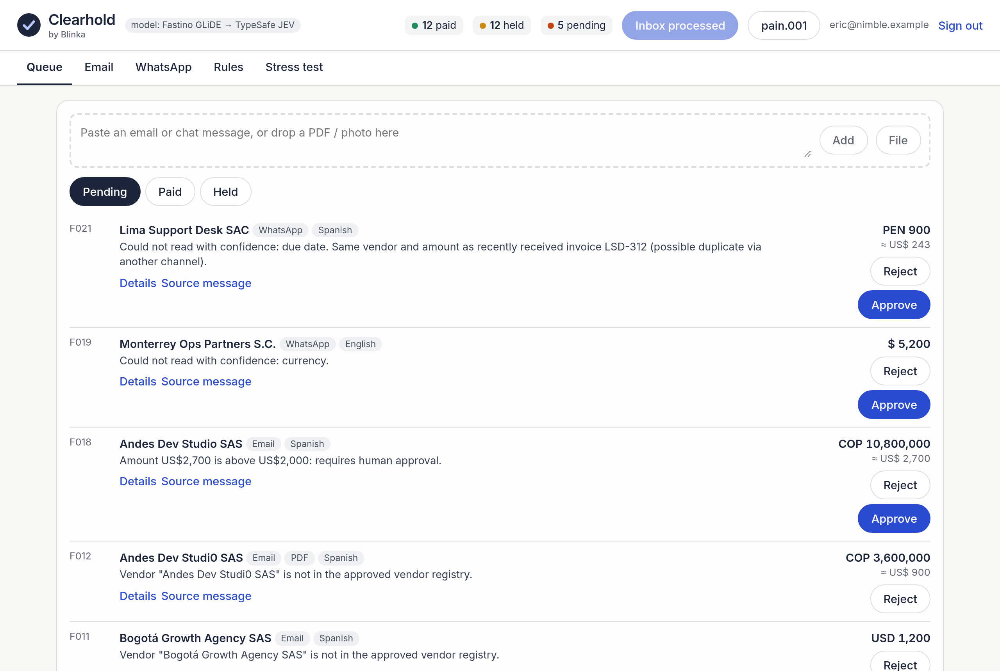

# Clearhold · by Blinka


Equipo / Team: Nimble · 30X Hackathon, reto Blinka.

[](https://github.com/ericmaster/blinka-ap-agent/actions/workflows/ci.yml)

| For judges | |
|---|---|
| Live demo | https://blinka-ap-agent.ericmaster.workers.dev (any email; demo mode shows the code) |
| 2-minute guide (EN/ES) | [`docs/JUDGE-GUIDE.md`](docs/JUDGE-GUIDE.md) |
| Pitch deck (3:00, ES) | HTML: https://blinka-ap-agent.ericmaster.workers.dev/pitch/ ([`docs/pitch/index.html`](docs/pitch/index.html)) · PPTX: [`docs/pitch/clearhold-pitch.pptx`](docs/pitch/clearhold-pitch.pptx) · PDF: [`docs/pitch/clearhold-pitch.pdf`](docs/pitch/clearhold-pitch.pdf) |
| Narrated demo video (75 s, ES) | [`docs/pitch/demo-narrated.mp4`](docs/pitch/demo-narrated.mp4) · [watch online](https://blinka-ap-agent.ericmaster.workers.dev/pitch/demo-narrated.mp4) · narration: [`docs/pitch/demo-narration.md`](docs/pitch/demo-narration.md) |
| 3-minute pitch video (2:54, ES) | [`docs/pitch/clearhold-pitch-3min.mp4`](docs/pitch/clearhold-pitch-3min.mp4) · [watch online](https://blinka-ap-agent.ericmaster.workers.dev/pitch/clearhold-pitch-3min.mp4) · script: [`docs/pitch/pitch-narration.md`](docs/pitch/pitch-narration.md) · backup screen capture: [`docs/demo-backup.mp4`](docs/demo-backup.mp4) |
| Run locally | **Node ≥ 22** required: `npm ci && npm test && npm run build && npm start` |

| Real | Simulated |
|---|---|
| Extraction (regex, PDF text via unpdf, OCR via tesseract.js), deterministic rules engine, decision models (Fastino GLiDE → TypeSafe JEV, yes/no only), decision log, OTP login and sessions, vendor dual approval, ISO 20022 pain.001 XML, translation (Workers AI), audit export (CSV/JSON), Cloudflare deploy | Mailbox and WhatsApp (mock services with their own API), Blinka payouts (mock, no money moves), notifications and login email (none sent; code shown on screen), fixed FX table. All data is synthetic (fictional Northwind Ridge Inc.). |

Full table, verified against the code (EN/ES): [`docs/REAL-VS-SIMULATED.md`](docs/REAL-VS-SIMULATED.md)



**UI EN / ES** — toggle **EN · ES** top right, next to your email (saved in this browser; shared by Clearhold, Mailbox, WhatsApp and Blinka mock pages). Decision reasons are translated with keyed templates (`src/i18n/`); evidence quotes and invoice text stay in their original language. English is the default. Screenshots: [`docs/screenshots/i18n-es.png`](docs/screenshots/i18n-es.png), realistic invoice in details: [`docs/screenshots/realistic-invoice.png`](docs/screenshots/realistic-invoice.png).

**ES** — **Clearhold** es un agente de cuentas por pagar para el reto **Blinka** (30X Hackathon). Recibe facturas por PDF, imagen, correo o chat, extrae beneficiario, monto, moneda y vencimiento, y decide **pagar / frenar / escalar** con reglas configurables, registro explicable y tablero. El modelo nunca autoriza un pago: las reglas duras viven en código y la duda se escala.

**EN** — **Clearhold** is an accounts-payable agent for the **Blinka** challenge (30X Hackathon). Ingests invoices from PDF, image, email or chat, extracts payee, amount, currency and due date, and decides **pay / hold / escalate** under configurable rules, with an explainable log and a dashboard. The model never authorizes a payment: hard rules live in code; uncertainty (p 0.2–0.8) or any error escalates. Output is a standard **ISO 20022 pain.001** file — no money moves.

## Arquitectura / Architecture
Reglas deterministas → GLiDE (Fastino, principal) → JEV (respaldo) → pagar · frenar · escalar → log + tablero → pain.001. Detalle: [`docs/SPEC.md`](docs/SPEC.md).

## Uso / Usage
```bash
npm ci && npm test                       # 0 pagos indebidos / zero improper payments (fake model)
node scripts/run.mjs data/curated        # decisions.jsonl, log.md, pain001.xml en out/
FASTINO_API_KEY=... JEV_API_KEY=... node scripts/run.mjs data/curated --real   # GLiDE → JEV
```
Reglas configurables: [`config/rules.json`](config/rules.json). Extracción: [`docs/EXTRACTION.md`](docs/EXTRACTION.md). Datos: [`docs/DATASET.md`](docs/DATASET.md).

## Dashboard
```bash
npm ci && npm run build && npm start      # http://localhost:8796  (FASTINO_API_KEY / JEV_API_KEY optional; without them every invoice escalates)
```
English UI. Sign in with email + one-time code (DEMO MODE shows the code on screen). Mock email inbox and WhatsApp chat are the primary feed ("Process new"), plus manual upload; each queue entry links to its source message. Details: NER-style schema with evidence span + confidence per field, rules applied, decision log with who/when, original PDF/image view + download, translation toggle (Workers AI m2m100 when deployed; otherwise the original with a note).

Pendientes / pagadas / frenadas con el porqué, aprobar o rechazar (la aprobación vuelve a verificar las reglas duras), reglas editables, carga de correo/chat/PDF/imagen (OCR en el navegador), prueba de estrés con Autonomía · Pagos indebidos · Explicabilidad, descarga pain.001.
Cloudflare Workers: `wrangler.toml` (KV `STATE`), `npx wrangler secret put FASTINO_API_KEY`, `npx wrangler deploy`.

## Evidencia / Evidence
[`bench/RESULTS.md`](bench/RESULTS.md): 30 facturas sintéticas — GLiDE 100% decisiones correctas, **0 pagos indebidos**.

```bash
cd bench && python3 -m venv .venv && .venv/bin/pip install requests  # if needed
export FASTINO_API_KEY=... JEV_API_KEY=...   # never commit keys
.venv/bin/python bench.py rules glide jev
```

## Repo
- `docs/` — SPEC, PROPUESTA (propuesta de valor, Lean Canvas, MoSCoW), canvas.html/png, PITCH, JUDGE-GUIDE
- `bench/` — bench de modelos de decisión y resultados
- `src/` — `extract/` (texto, PDF, OCR), `engine/` (reglas), `adapters/` (GLiDE, JEV, fakes), `output/` (pain.001), `gen/` (generador)

Datos 100% ficticios / fully synthetic data. Licencia MIT.
